# TunePay: Voice-Enabled UPI Payment System

TunePay is a multi-service UPI payment platform that combines a React Native (Expo) mobile app with Django transaction APIs, a Flask voice-intelligence service, and a Rasa conversational assistant.

TunePay is the React Native rebrand of [EchoPay](https://github.com/jefin10/EchoPay). Commit history before the rebrand includes the original Flutter client, which the EchoPay repository keeps shipping.

## Project Overview

The platform supports manual and voice-first payment interactions. Voice input is processed by a TensorFlow-based intent classifier (CNN architecture), with entity extraction and conversational fallback behavior.

## Core Capabilities

- Voice-assisted payment flow and balance inquiry support
- CNN-based intent classification for payment commands
- Conversational fallback through Rasa
- Phone number and UPI ID based money transfer
- OTP-led onboarding and account access
- Transaction and money request management

## Screenshots

Captured from the Android app on a Samsung Galaxy A31, signed in as a demo user with sample data.

### Sign in and home

<table>
  <tr>
    <td align="center">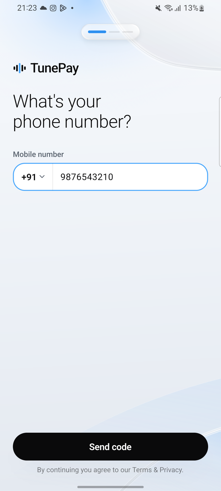<br><sub>Sign in</sub></td>
    <td align="center">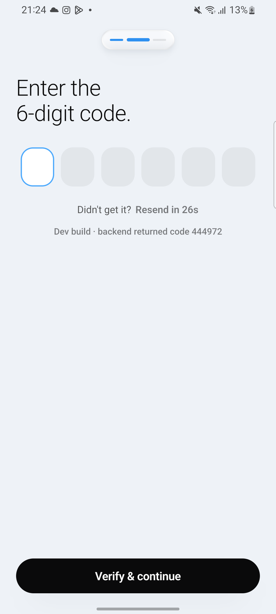<br><sub>Verify code</sub></td>
    <td align="center">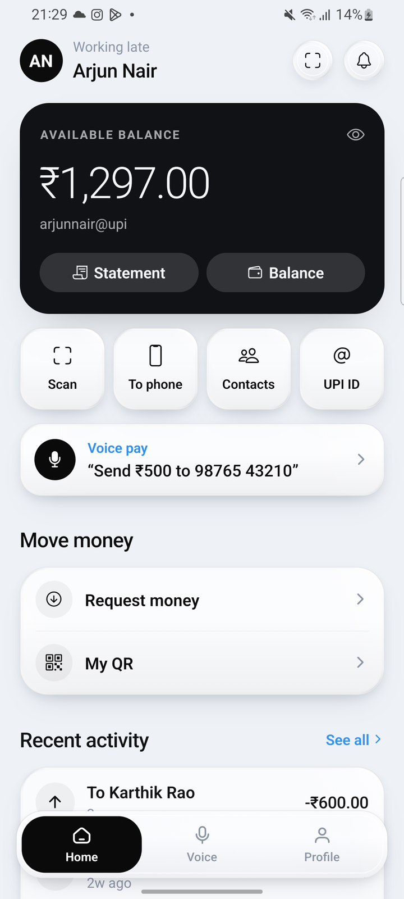<br><sub>Home</sub></td>
    <td align="center">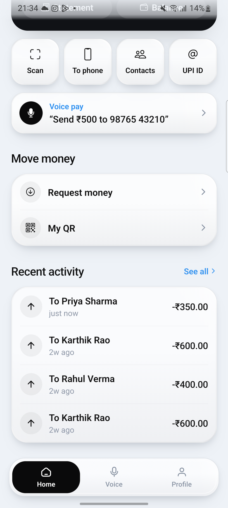<br><sub>Recent activity</sub></td>
  </tr>
</table>

### Money

<table>
  <tr>
    <td align="center">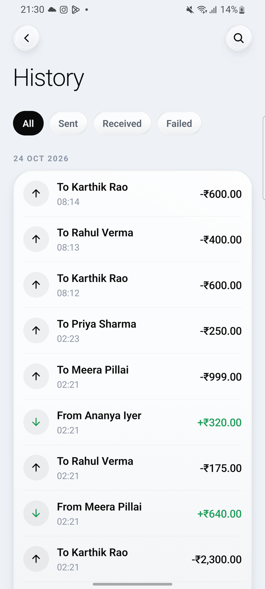<br><sub>History</sub></td>
    <td align="center"><br><sub>Balance</sub></td>
    <td align="center">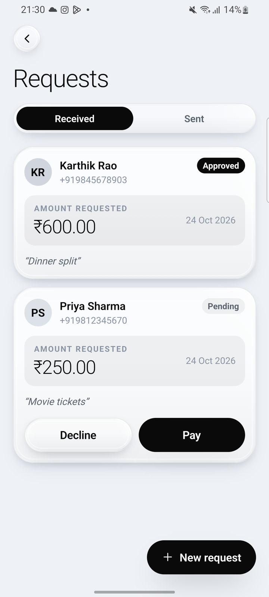<br><sub>Requests</sub></td>
    <td align="center">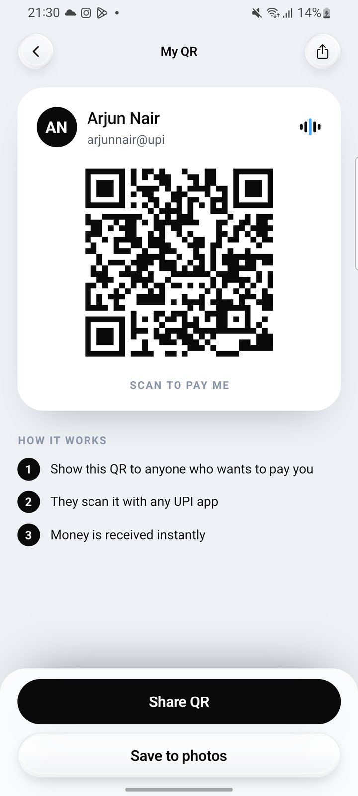<br><sub>My QR</sub></td>
  </tr>
</table>

### Payments

<table>
  <tr>
    <td align="center">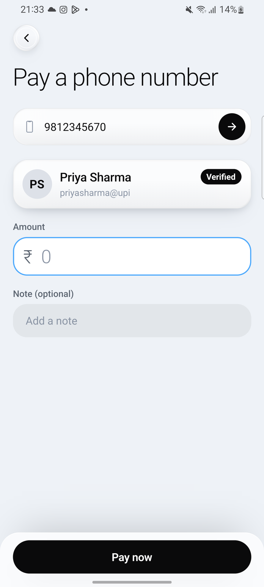<br><sub>Pay a phone number</sub></td>
    <td align="center">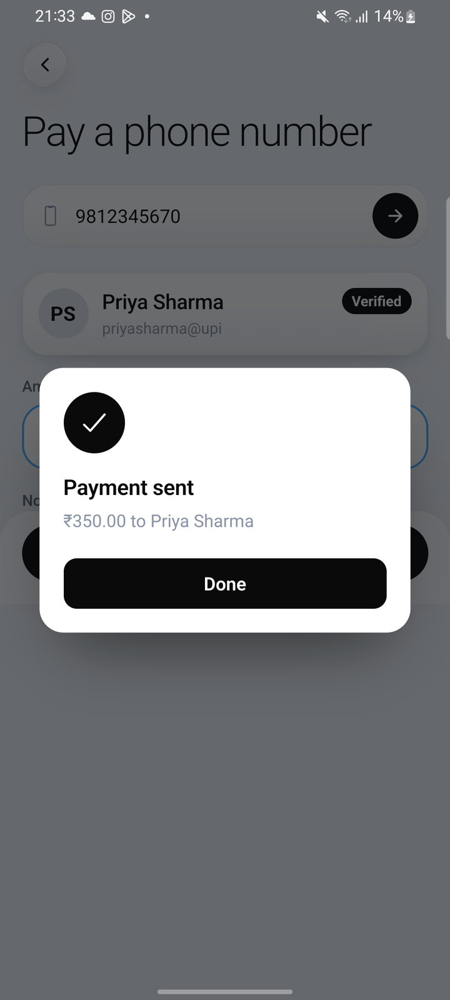<br><sub>Payment sent</sub></td>
    <td align="center"><br><sub>Pay a UPI ID</sub></td>
  </tr>
</table>

### Voice

<table>
  <tr>
    <td align="center">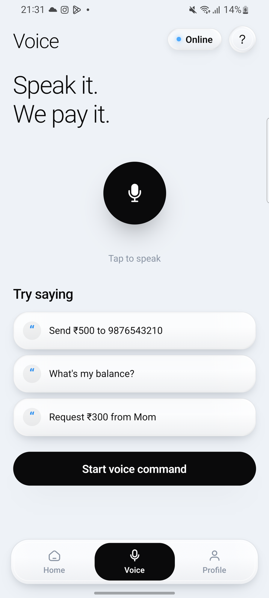<br><sub>Voice</sub></td>
    <td align="center"><br><sub>Voice pay</sub></td>
  </tr>
</table>

### Profile

<table>
  <tr>
    <td align="center">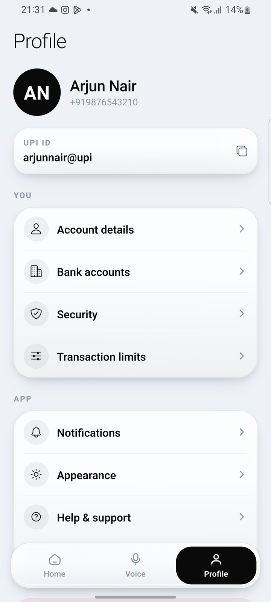<br><sub>Profile</sub></td>
    <td align="center">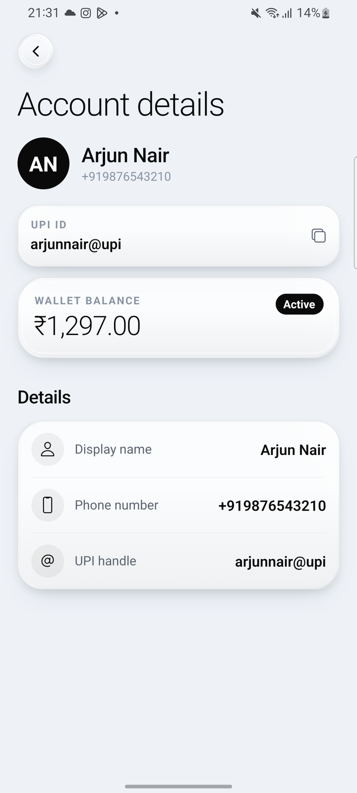<br><sub>Account details</sub></td>
    <td align="center">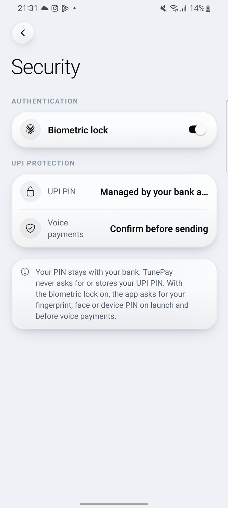<br><sub>Security</sub></td>
    <td align="center">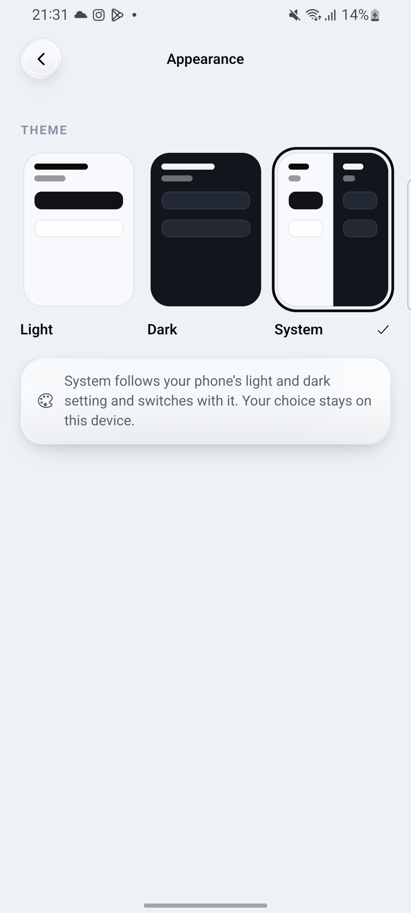<br><sub>Appearance</sub></td>
  </tr>
  <tr>
    <td align="center">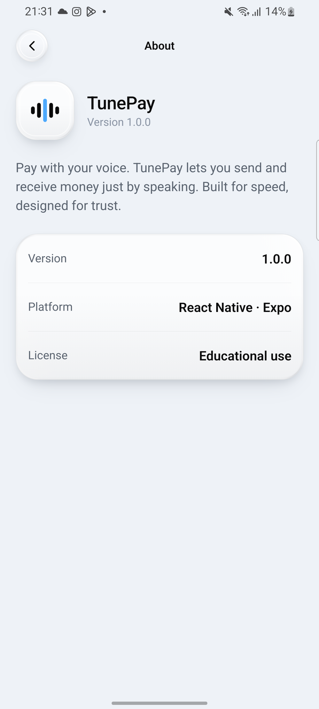<br><sub>About</sub></td>
  </tr>
</table>

### Dark mode

<table>
  <tr>
    <td align="center">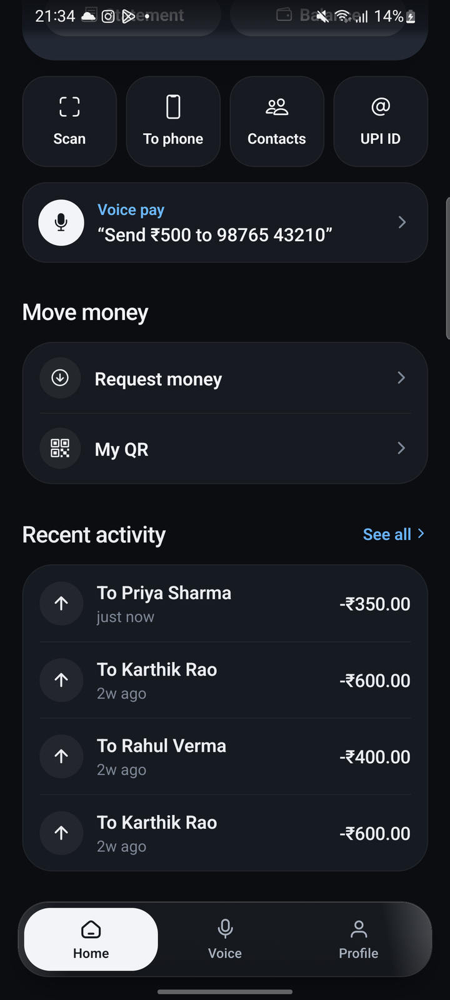<br><sub>Home</sub></td>
    <td align="center">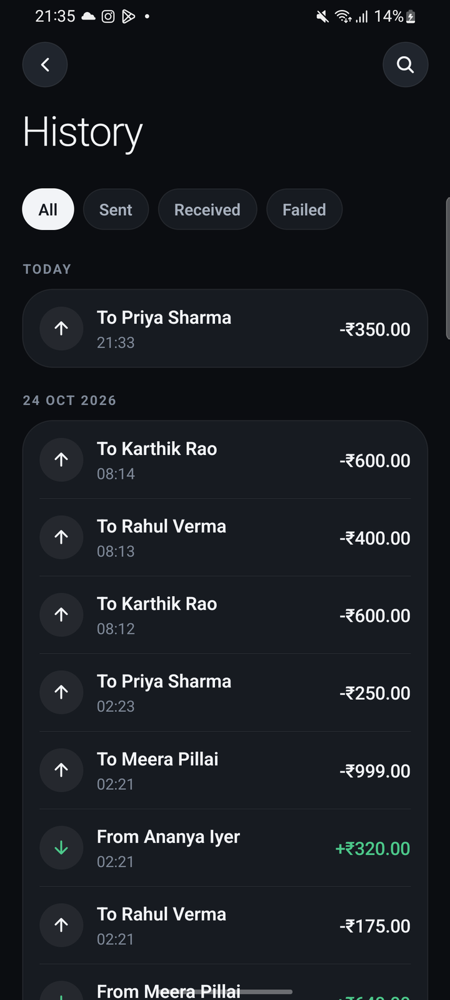<br><sub>History</sub></td>
    <td align="center">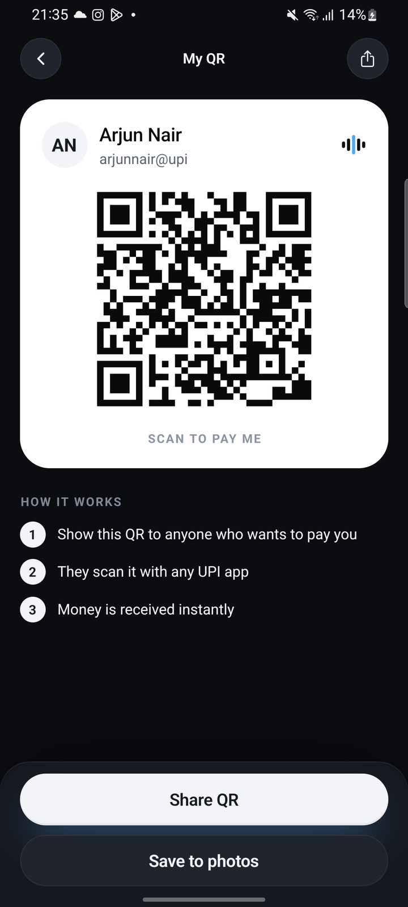<br><sub>My QR</sub></td>
    <td align="center">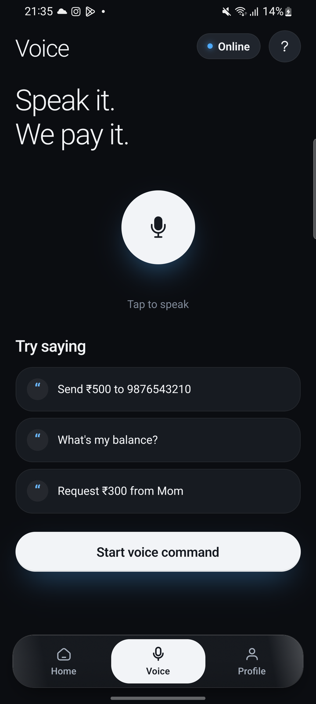<br><sub>Voice</sub></td>
  </tr>
</table>

## Technology Stack

- Mobile app: React Native 0.88 + Expo SDK 58, TypeScript, Expo Router, React Query
- Landing page: Next.js 16 + Tailwind CSS 4
- Backend APIs: Django 5.1.6 + PostgreSQL 15
- Voice Intelligence Service: Flask 2.3.3 + TensorFlow 2.17 (CNN classifier)
- Conversational AI: Rasa 3.6.0
- Containerization: Docker + Docker Compose

## System Architecture

```
+-----------------------+
|   Mobile App (Expo)   |
|  Voice and Manual UX  |
+-----------+-----------+
            |
            |
  +---------+---------+-------------------+
  |                   |                   |
  v                   v                   v
+----------------+ +----------------+ +----------------+
| Django API     | | Flask Voice    | | Rasa Service   |
| Port 8000      | | Port 5002      | | Port 5005      |
| Auth, UPI, Txn | | CNN + Entities | | Conversation   |
+-------+--------+ +--------+-------+ +----------------+
        |                   |
        +---------+---------+
                  |
                  v
        +--------------------+
        | PostgreSQL         |
        | Port 5432          |
        | Persistent Storage |
        +--------------------+
```

## Repository Structure

```
TunePay/
├── apps/
│   ├── mobile/                   # React Native (Expo) app
│   └── web/                      # Next.js landing page
├── services/
│   ├── api/                      # Django: auth, accounts, transfers, requests
│   ├── voice/                    # Flask: intent classification + entities
│   │   ├── app/                  #   server
│   │   ├── models/               #   trained intent + NER models
│   │   └── training/             #   notebooks and dataset
│   ├── chatbot/                  # Rasa conversational fallback
│   └── docker-compose.yml        # runs api, voice, chatbot + PostgreSQL
├── docs/
│   ├── api.md                    # Django API reference
│   ├── voice-api.md              # Flask voice API reference
│   └── screenshots/              # app screenshots shown above
└── README.md
```

## Getting Started

### 1. Clone and Enter the Repository

```bash
git clone https://github.com/jefin10/TunePay.git
cd TunePay
```

### 2. Start Backend Services

```bash
cd services
docker compose up -d --build
docker compose ps
```

### 3. Run the Mobile App

```bash
cd apps/mobile
npm install
cp .env.example .env.local   # set EXPO_PUBLIC_API_HOST
npm run android              # builds a development build and starts Metro
```

`EXPO_PUBLIC_API_HOST` is the machine running the services:

- Android emulator: `10.0.2.2`
- iOS simulator: `localhost` or host IP
- Physical device: host machine LAN IP

See [`apps/mobile/README.md`](apps/mobile/README.md) for tests, project layout and release builds.

### 4. Landing Page (optional)

```bash
cd apps/web
npm install
npm run dev
```

## Docker Operations

Run these from `services/`:

```bash
docker compose logs -f
docker compose restart
docker compose down
docker compose up -d --build
```

## Service Endpoints

- Django: `http://localhost:8000`
- Flask: `http://localhost:5002`
- Rasa: `http://localhost:5005`

## API Documentation

- Django API: [`docs/api.md`](docs/api.md)
- Flask voice API: [`docs/voice-api.md`](docs/voice-api.md)
- Retraining the intent model: open `services/voice/training/model_training.ipynb`; it writes the model files into `services/voice/models/intent/`.

## Known Limitations

- The Django API has no authentication: endpoints trust the phone number sent by the client. Do not deploy it with real money.
- OTPs are generated but not sent by SMS; with `DEBUG` on, the backend returns the code in the response.

## License

Educational purposes only.
